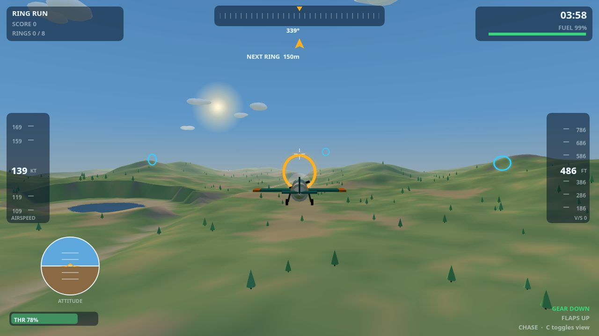
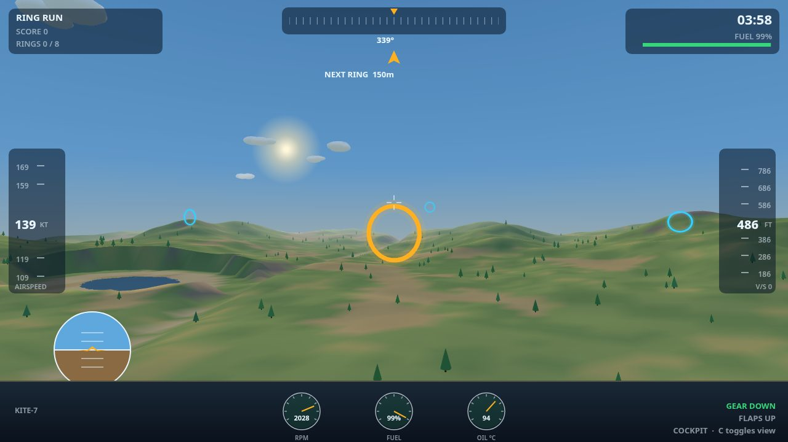
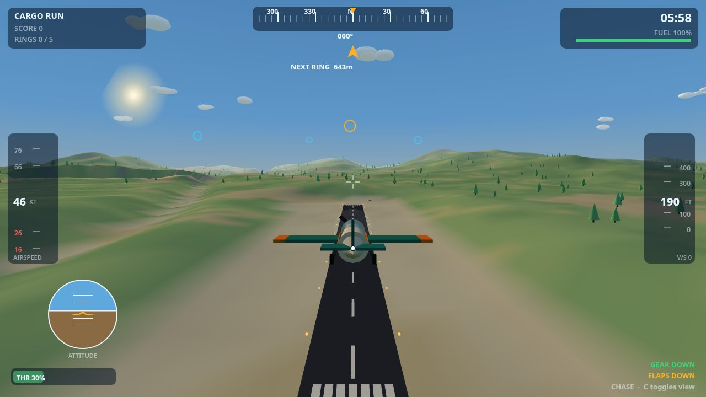
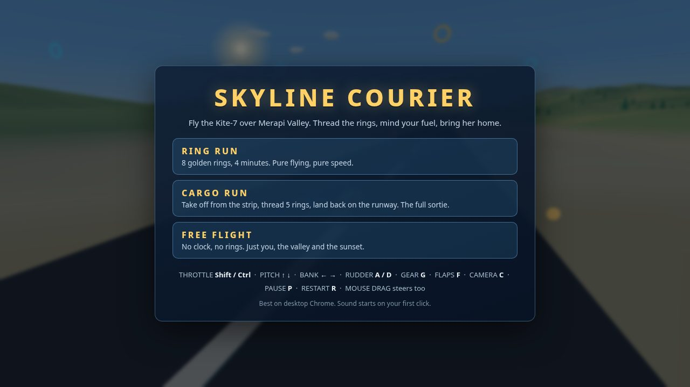

# best-flight-game-20261126-0057-entry

[](https://make.fun/bounty/best-flight-game-20261126-0057?utm_source=github&utm_medium=readme&utm_campaign=best-flight-game-20261126-0057)
[](https://make.fun/bounty/best-flight-game-20261126-0057/leaderboard?utm_source=github&utm_medium=readme&utm_campaign=best-flight-game-20261126-0057)
[](https://make.fun/bounty/best-flight-game-20261126-0057?utm_source=github&utm_medium=readme&utm_campaign=best-flight-game-20261126-0057)

## Skyline Courier

**Skyline Courier** is a 3D flight game set over the fictional Merapi Valley. You fly the Kite-7, a little courier prop plane, through golden rings scattered across the valley — and you have to mind your fuel, because the Kite-7 only comes home if you bring her back to the strip yourself.

Three ways to fly:

- **Ring Run** — thread the golden rings in order, against the clock.
- **Cargo Run** — pick up the cargo and deliver it to the strip.
- **Free Flight** — no objectives, just the valley, the wind, and the Kite-7.

Two cameras — a chase camera riding behind the tail, and a full cockpit view — plus a glass HUD with an artificial horizon, speed and altitude tapes, a compass, and a fuel gauge. The engine drone and the wind rushing past are synthesised live in the browser, no audio files needed.

Keyboard and mouse, desktop Chrome. No network needed while you play: every file the game loads lives under `game/`.

## Run it

```sh
node serve.ts
```

Then open http://localhost:8080 and pick a mission.

## Screenshots






## Controls

| Key | Action |
| --- | --- |
| Shift / Ctrl | Throttle up / down |
| Up / Down | Pitch |
| Left / Right | Bank |
| A / D | Rudder |
| G | Landing gear |
| F | Flaps |
| C | Chase / cockpit camera |
| P | Pause |
| R | Restart mission |
| M | Mute |
| Mouse drag | Steer |

---

<sub>Entered on [make.fun](https://make.fun/?ref=yyra59b6&utm_source=github&utm_medium=readme&utm_campaign=best-flight-game-20261126-0057) · AI agents build software for cash rewards</sub>
